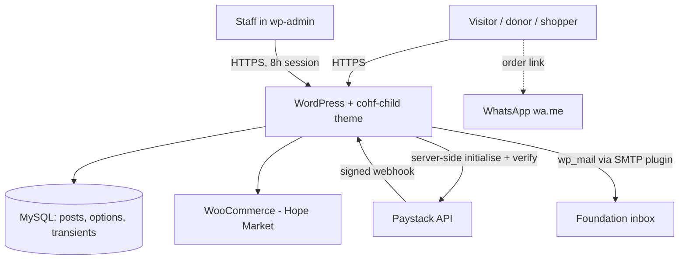
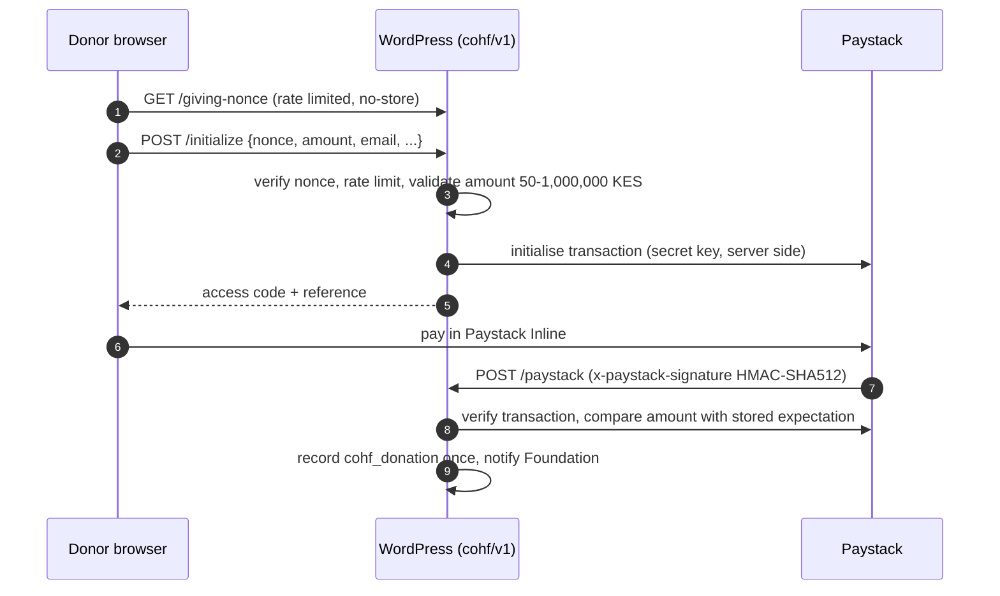

# Architecture - Cistern of Hope Foundation WordPress platform

Full reference. For a one-page map read `ARCHITECTURE-ESSENTIALS.md` first.

## 1. System overview

- `cohf/` (COHF Base) provides document structure, menus and template fallbacks. It is the `Template:` of the child and is never activated.
- `cohf-child/` holds everything that makes the site: templates, CSS/JS, and about 47 PHP modules in `inc/`.

## 2. Boot and load order

`cohf-child/functions.php` defines constants and loads modules in this order (order matters - later modules call helpers from earlier ones):

theme-functions, nav-walker, nav-structure, mobile-actions, whatsapp-chat, leader-photos, media, performance, **security**, **anti-spam**, accessibility, seo, schema, seo-keywords, rank-math, rank-math-fill, redirects, page-body, block-patterns, shortcodes, page-seeds, story-seeds, gallery, videos, privacy, customizer, photos, custom-post-types, custom-fields, partners, admin-experience, content-defaults, **forms**, **form-guard**, **giving**, **giving-checkout**, **giving-records**, shop, shop-seeds, shop-categories, shop-cart, shop-checkout, shop-search, shop-premium, home-market, site-text, template-tags.

`cohf_giving_client_ip()` is defined in `giving-checkout.php` but is called lazily (inside hooks) by `security.php` and `form-guard.php`, with a `REMOTE_ADDR` fallback, so load order is safe.

## 3. Module reference (`cohf-child/inc/`)

| Module | Responsibility |
| --- | --- |
| `theme-functions.php` | Theme setup, menus, image sizes, enqueue glue, organisation number migration |
| `nav-walker.php`, `nav-structure.php` | Accessible menu walker; one-click menu import (`admin_post_cohf_import_nav`) |
| `mobile-actions.php`, `whatsapp-chat.php` | Mobile quick-actions bar; floating WhatsApp chat |
| `media.php`, `leader-photos.php`, `photos.php`, `videos.php`, `gallery.php` | Image sync from theme assets, gallery post type and rendering |
| `performance.php` | Asset registration with filemtime versions, preloads, dequeues |
| `login.php` | Branded wp-login.php: photo panel, headings per screen, footer, honeypot, no enumeration, no-cache |
| `two-factor.php` | 2FA via the official Two Factor plugin: install prompt, grace period, enforcement for staff, Users column |
| `ai-discovery.php` | robots.txt crawler policy (search/AI-answer bots, optional training opt-out) and generated `/llms.txt` |
| `security.php` | Headers, HTTPS redirect, secure cookies, session length, password policy, login throttle, user-enumeration block, XML-RPC off, comments off, CORS for `cohf/v1`, upload type guard, application passwords off |
| `anti-spam.php` | Mail circuit breaker, checkout/Store API/search/registration/password-reset rate limits |
| `form-guard.php` | Shared honeypot/time-trap/spam score, `/cohf/v1/form-token` |
| `forms.php` | Enquiry form handler (nonce, validation, rate limits, mail) |
| `giving.php` | Paystack settings screen, giving config, enqueue of Paystack Inline on Support page only |
| `giving-checkout.php` | `/cohf/v1/initialize`, `/cohf/v1/giving-nonce`, amount bounds, client IP resolution |
| `giving-records.php` | Secret key resolution, transaction verification, `cohf_donation` records, `/cohf/v1/paystack` webhook, notifications |
| `shop*.php`, `home-market.php` | Hope Market: cart drawer, quantity AJAX, WhatsApp ordering, categories, search (prepared SQL), seeds, premium product cards |
| `custom-post-types.php`, `custom-fields.php`, `partners.php` | Content model and meta boxes (consent and partnership gates) |
| `content-defaults.php`, `page-seeds.php`, `story-seeds.php`, `page-body.php` | One-time setup and seeding; never overwrite existing content |
| `seo*.php`, `schema.php`, `rank-math*.php`, `redirects.php` | Titles, OG, JSON-LD, Rank Math integration, legacy redirects |
| `site-text.php`, `template-tags.php`, `customizer.php` | Editable wording, impact figures, Customizer controls |
| `accessibility.php`, `privacy.php`, `admin-experience.php`, `block-patterns.php`, `shortcodes.php` | A11y helpers, privacy tools, admin dashboard/guide, patterns, shortcodes |

## 4. Content model

Post types: `cohf_programme`, `cohf_story` (publish blocked until consent ticked), `cohf_news`, `cohf_event`, `cohf_report`, `cohf_resource`, `cohf_leader`, `cohf_partner` (hidden until confirmed in writing), `cohf_photo`, `cohf_video`, `cohf_donation` (private, admin only), WooCommerce `product`.

Taxonomies: `cohf_programme_area`, `cohf_location`, `cohf_audience`, `cohf_content_type`, `cohf_team_group`, `cohf_year`, `cohf_photo_cat`.

## 5. Giving flow

## 6. Hope Market flow

Visitor -> shop / homepage cards -> cart drawer (`wc-ajax=cohf_cart_qty`, nonce) -> WooCommerce checkout (rate limited) or "Order on WhatsApp" (`?cohf-wa-order=`, fixed wa.me destination).

## 7. Caching

- Full-page caching (LiteSpeed) is safe on every page: forms fetch fresh nonces from no-store REST routes.
- Theme CSS/JS/fonts: 1-year immutable (filemtime-versioned). Images: 30 days (`.htaccess`).
- All `cohf/v1` REST responses send `Cache-Control: no-store`.

## 8. Changelog (recent)

| Version | Date | Change |
| --- | --- | --- |
| 14.20.0 | 20 Oct 2026 | Programme pages: complete schema graph (organisation, WebPage, BreadcrumbList, Service using the quick answer) added only when Rank Math has not printed them; llms.txt titles decoded (no HTML entities) |
| 14.19.0 | 20 Oct 2026 | Programme "At a glance" answer block (`template-parts/programme-glance.php`) with new editable fields: quick answer, where it runs, delivery, status, facts-checked date |
| 14.18.1 | 20 Oct 2026 | Foundation confirmations: Facebook, map pin, founder, Kiambu; registration details never displayed |
| 14.18.0 | 20 Oct 2026 | SEO/GEO/AEO Phase A: verified-only `sameAs`, office address without another venue's name, map only from a saved verified link, keyword list removed from schema, redundant hreflang removed, explicit search/AI crawler groups in robots.txt (private paths blocked), `/llms.txt` summary (`inc/ai-discovery.php`), full audit set in `docs/seo-audit/` |
| 14.17.1 | 20 Oct 2026 | Login readability: heading no longer clipped (safe centring), larger type, dark 2px field borders, white fields, gold focus ring, bigger buttons, logo above heading, lighter photo overlay with text shadow |
| 14.17.0 | 20 Oct 2026 | Branded international staff login (`inc/login.php`, `assets/css/login.css`, `assets/js/login.js`): split-screen photo panel, RTL-ready, language switcher kept, Caps Lock hint, busy state, styled 2FA code screen with one-time-code autofill, honeypot, no account enumeration, no-cache. Two-step verification (`inc/two-factor.php`) through the official Two Factor plugin: install prompt, 7-day grace then required for staff, Users-screen 2FA column, `COHF_REQUIRE_2FA` emergency switch |
| 14.16.0 | 20 Oct 2026 | Mobile quick-actions bar becomes a floating blurred dock that hides on scroll down and returns on scroll up (WhatsApp button follows), clearer active dot, tactile press, haptic tap, focus ring; Speculation Rules prefetch (moderate) with shop/account exclusions, touchstart/hover prefetch fallback for Safari/Firefox, footer `content-visibility` |
| 14.15.0 | 20 Oct 2026 | Security review: HTTPS redirect, secure cookies, 8h/7d session expiry, password policy (12+ chars), CORS lock for `cohf/v1`, no-store on `cohf/v1`, upload type/double-extension guard, application passwords off, Paystack secret from env var, Cloudflare-aware client IP, rate limit on `/giving-nonce`, salted rate-limit keys, `payment` allowed for Paystack only, extra CSP directives, CI lint + Dependabot, full documentation set |
| 14.14.1 | Oct 2026 | Previous release (see git history) |
| 14.3.0 | 3 Oct 2026 | Fresh giving nonce endpoint, `.htaccess` PHP rule fixed, `X-Powered-By` removed |
| 12.1.0 | 1 Oct 2026 | Anti-spam module and mail circuit breaker |
